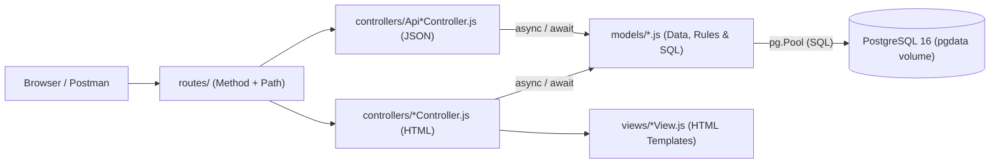

# 🎓 Alumni Tracking System (`alumni`)

[](https://nodejs.org/)
[](https://expressjs.com/)
[](https://www.postgresql.org/)
[](./docker-compose.yml)
[](http://localhost:3000/api/swagger)
[](./ddd.md)

A full-stack **Alumni Tracking System** built week by week for the **Web Programming (YBSB3001)** course at **Istanbul University, Department of Management Information Systems (Fall 2026)**, taught by **Assoc. Prof. Dr. Emre Akadal**.

- **Author:** Ege Gürkan Atalay (`egegurkanatalay@ogr.iu.edu.tr`)
- **Repository:** [`https://github.com/egegurata/alumni`](https://github.com/egegurata/alumni)
- **Database Design Document (Source of Truth):** 👉 **[`ddd.md`](./ddd.md)**

---

## 🎯 What the System Is & What It Must Do

The **Alumni Tracking System** connects university graduates (`isAlumni: true`) and current students (`isAlumni: false`) in a unified platform. It provides:
1. **Alumni & Student Directory (`users`):** Full CRUD management of member profiles (`name`, `email`, `department`, `graduationYear`, `isAlumni`, `company`, `jobTitle`) via both RESTful JSON APIs (`/api/users`) and Server-Side Rendered HTML views (`/users`).
2. **University & Career Bulletins (`announcements`):** Full CRUD management of institutional notices, career fairs, and homecoming events (`/api/announcements` and `/announcements`).
3. **Alumni Job Postings (`job_postings` — One-to-Many):** Graduates publish job and internship opportunities linked to their user profile (`users.id -> job_postings.user_id`), accessible via nested routes (`/api/users/:id/jobs`), included inside user lookups (`GET /api/users/:id` via `LEFT JOIN`), and managed via `/api/jobs` and `/jobs`.
4. **Candidate Job Applications (`applications` — Many-to-Many Join Table):** Users apply to job postings through the `applications` join table (`POST /api/jobs/:id/applications`), enforcing foreign key existence (`404 Not Found`) and composite uniqueness `UNIQUE (user_id, job_posting_id)` (`409 Conflict` on duplicate application).
5. **Interactive API Documentation:** Live OpenAPI 3.0 Swagger UI served at [`/api/swagger`](http://localhost:3000/api/swagger).

---

## 💻 Language & Database Choice (Why & One Weakness of Each — Week 01)

In Week 01, we selected our back-end language/runtime and database management system for the fourteen-week term:

| Layer | Chosen Technology | Why We Chose It (Reason) | One Weakness (What It Is Bad At) |
| :--- | :--- | :--- | :--- |
| **Back-End Language & Framework** | **JavaScript (Node.js & Express.js 5)** | Event-driven, non-blocking I/O model handles thousands of concurrent HTTP requests and asynchronous database queries (`async/await`) with minimal overhead; native JSON support and clean routing/middleware syntax make REST API and MVC development fast and transparent. | **Single-threaded Event Loop & Dynamic Typing:** Heavy **CPU-bound** tasks (e.g., complex mathematical computation, image/video encoding) block the single main thread and delay all incoming requests; additionally, dynamic typing allows type errors to slip into runtime unless explicitly validated. |
| **Database (DBMS)** | **PostgreSQL 16** (`postgres:16-alpine`) | Enterprise-grade relational database with strict **ACID** transactions, native enforcement of `PRIMARY KEY`, `FOREIGN KEY` (`ON DELETE CASCADE`), `UNIQUE (user_id, job_posting_id)` composite constraints, and high-performance `LEFT JOIN` & JSON aggregation (`json_agg`). | **Horizontal Write Scaling & Connection Overhead:** Unlike distributed NoSQL stores, PostgreSQL is harder to scale horizontally (write sharding across multiple nodes is complex), and its process-per-connection architecture consumes significant RAM under high concurrency without a connection pooler (`pg.Pool`). |

---

## 📐 Core Repository Rules (Week 05 & Week 06)

1. **[`ddd.md`](./ddd.md) is the Source of Truth:** Every table, column, type, key, relation, delete rule (`ON DELETE CASCADE`), and volume is designed first in [`ddd.md`](./ddd.md) before any code or SQL is written.
2. **Tables Change Only Through Migrations:** Never alter database tables manually. Every schema addition travels as a numbered SQL file inside [`migrations/`](./migrations) and is applied via `npm run migrate`. Never edit an old migration that has already run; add a new migration file instead.
3. **`.env` Never Goes to GitHub:** Local secrets and passwords live in `.env` (which is ignored by [`.gitignore`](./.gitignore) and [`.dockerignore`](./.dockerignore)). Only [`.env.example`](./.env.example) (with the exact same keys and placeholder values) is committed to the repository.
4. **One Command Target:** The entire system (Node.js app + PostgreSQL 16 + persistent `pgdata` volume + migrations + seed data) comes up with a single command: `docker compose up`.

---

## 🏛️ Architecture (MVC — Three Jobs, Three Places)

To prevent spaghetti code, the codebase strictly follows the **Model–View–Controller (MVC)** pattern. Same data, two views (JSON for programs, HTML tables for people), one shared Model:



### Folders and Files (One Sentence Each — Week 04 Requirement)

- **[`index.js`](./index.js):** Application entry point that configures Express middleware, static files, the HTML view engine, Swagger UI (`/api/swagger`), Week 02 utility routes (`/hello`, `/sum/:a/:b`), `/api/health`, and mounts all MVC routers.
- **[`ddd.md`](./ddd.md):** The Database Design Document serving as the single source of truth for all tables, fields, data types, foreign keys, unique constraints, delete rules (`CASCADE`), and Docker volume configuration.
- **[`swagger.json`](./swagger.json):** OpenAPI 3.0 specification describing every REST endpoint, path parameter, request body schema, and HTTP status code served at `/api/swagger`.
- **[`docker-compose.yml`](./docker-compose.yml):** Multi-container Docker orchestration defining the `web` (Node.js) and `db` (PostgreSQL 16) services along with the persistent `pgdata` named volume.
- **[`Dockerfile`](./Dockerfile):** Container build recipe for the Node.js application that installs dependencies and runs migrations, seeding, and the Express server on startup.
- **[`.env.example`](./.env.example):** Committed environment variable template listing all required configuration keys without exposing real passwords.
- **`models/` (Data, Validation Rules & Database Queries):**
  - **[`models/db.js`](./models/db.js):** Centralized PostgreSQL connection pool (`pg.Pool`) that reads environment variables and manages database connections.
  - **[`models/User.js`](./models/User.js):** Holds user data, enforces the mandatory/unique email rule, maintains the monotonically increasing ID counter, and executes SQL queries including the `LEFT JOIN` for a user's job postings.
  - **[`models/Announcement.js`](./models/Announcement.js):** Manages institutional announcement records, validates required fields, and executes CRUD queries against the `announcements` table.
  - **[`models/JobPosting.js`](./models/JobPosting.js):** Manages job posting records (`job_postings`), verifies foreign key ownership (`user_id -> users.id`), and supports filtering and cascade cleanup.
  - **[`models/Application.js`](./models/Application.js):** Manages the `applications` many-to-many join table, verifying user and job existence (`404`) and enforcing the `UNIQUE (user_id, job_posting_id)` rule (`409 Conflict`).
  - **[`models/index.js`](./models/index.js):** Aggregates and exports all domain models and the database connection pool from a single module.
- **`controllers/` (Request Handling & HTTP Status Decisions):**
  - **[`controllers/ApiUserController.js`](./controllers/ApiUserController.js):** Handles JSON API requests for `/api/users`, translating model results and validation/conflict errors into semantic HTTP status codes (`200`, `201`, `204`, `400`, `404`, `409`).
  - **[`controllers/UserController.js`](./controllers/UserController.js):** Handles browser requests for `/users`, rendering HTML directory tables, edit forms, and individual user profile pages with their job postings.
  - **[`controllers/ApiAnnouncementController.js`](./controllers/ApiAnnouncementController.js):** Handles JSON CRUD requests for `/api/announcements` with proper status codes.
  - **[`controllers/AnnouncementController.js`](./controllers/AnnouncementController.js):** Handles browser requests for `/announcements`, rendering the HTML management interface and forms.
  - **[`controllers/ApiJobPostingController.js`](./controllers/ApiJobPostingController.js):** Handles JSON requests for both direct (`/api/jobs`) and nested (`/api/users/:id/jobs`) job posting routes.
  - **[`controllers/JobPostingController.js`](./controllers/JobPostingController.js):** Handles browser requests for `/jobs` and `/users/:id/jobs`, rendering the career board and job detail pages.
  - **[`controllers/ApiApplicationController.js`](./controllers/ApiApplicationController.js):** Handles JSON requests for `/api/jobs/:id/applications`, `/api/users/:id/applications`, and `/api/applications`, returning `201`, `404`, or `409`.
  - **[`controllers/ApplicationController.js`](./controllers/ApplicationController.js):** Handles browser requests for `/applications`, rendering candidate submission lists and status update forms.
- **`routes/` (The Table of Contents — Method + Path Mapping Only):**
  - **[`routes/apiUser.js`](./routes/apiUser.js):** Maps `/api/users` endpoints to `ApiUserController` and mounts nested `/:userId/jobs` and `/:userId/applications` routers.
  - **[`routes/user.js`](./routes/user.js):** Maps `/users` web endpoints to `UserController` and nested user job/application views.
  - **[`routes/apiAnnouncement.js`](./routes/apiAnnouncement.js):** Maps `/api/announcements` CRUD endpoints to `ApiAnnouncementController`.
  - **[`routes/announcement.js`](./routes/announcement.js):** Maps `/announcements` web endpoints to `AnnouncementController`.
  - **[`routes/apiJobPosting.js`](./routes/apiJobPosting.js):** Maps `/api/jobs` and `/api/users/:userId/jobs` endpoints to `ApiJobPostingController` and mounts nested `/:jobId/applications`.
  - **[`routes/jobPosting.js`](./routes/jobPosting.js):** Maps `/jobs` web endpoints to `JobPostingController`.
  - **[`routes/apiApplication.js`](./routes/apiApplication.js):** Maps `/api/applications` and nested application endpoints to `ApiApplicationController`.
  - **[`routes/application.js`](./routes/application.js):** Maps `/applications` web endpoints to `ApplicationController`.
  - **[`routes/index.js`](./routes/index.js):** Central export module for all route files.
- **`views/` & `public/` (Presentation Layer):**
  - **[`views/UserView.js`](./views/UserView.js):** Turns user arrays and single user objects (with their job postings) into HTML pages (`users.html`, `userDetail.html`, `userEdit.html`).
  - **[`views/AnnouncementView.js`](./views/AnnouncementView.js):** Turns announcement data into HTML pages (`announcements.html`, `announcementDetail.html`, `announcementEdit.html`).
  - **[`views/JobPostingView.js`](./views/JobPostingView.js):** Turns job posting data and applicant lists into HTML pages (`jobs.html`, `jobDetail.html`, `jobEdit.html`).
  - **[`views/ApplicationView.js`](./views/ApplicationView.js):** Turns application records into HTML pages (`applications.html`, `applicationDetail.html`).
  - **[`public/index.html`](./public/index.html):** Static home page dashboard served at `GET /`.
  - **[`public/about.html`](./public/about.html):** Static sub-page describing the project and architecture served at `GET /about`.
- **`migrations/`, `factories/`, `scripts/` & `test/`:**
  - **[`migrations/001_create_users_and_announcements.sql`](./migrations/001_create_users_and_announcements.sql):** First SQL migration creating the `users` and `announcements` tables, indexes, and `updated_at` triggers.
  - **[`migrations/002_create_job_postings_and_applications.sql`](./migrations/002_create_job_postings_and_applications.sql):** Second SQL migration creating the `job_postings` and `applications` tables with foreign keys (`ON DELETE CASCADE`) and `UNIQUE (user_id, job_posting_id)`.
  - **[`factories/UserFactory.js`](./factories/UserFactory.js):** Generates realistic alumni and student records for seeding and testing.
  - **[`factories/AnnouncementFactory.js`](./factories/AnnouncementFactory.js):** Generates realistic announcement records across valid categories.
  - **[`factories/JobPostingFactory.js`](./factories/JobPostingFactory.js):** Generates realistic job postings linked to existing users.
  - **[`factories/ApplicationFactory.js`](./factories/ApplicationFactory.js):** Generates realistic job applications linking users and job postings.
  - **[`scripts/migrate.js`](./scripts/migrate.js):** Migration runner (`npm run migrate`) that applies pending SQL migrations in alphabetical order.
  - **[`scripts/seed.js`](./scripts/seed.js):** Idempotent database seeder (`npm run seed`) that truncates tables in child-to-parent order, resets ID sequences (`RESTART IDENTITY`), and populates fresh rows.
  - **[`test/`](./test):** Automated test suite using Node's native test runner (`npm test`) verifying every Week 02–06 requirement.

---

## 🚀 How to Run the Project from Zero

A stranger can run the entire project from this README alone using either **Docker Compose (One Command)** or **Step-by-Step Local Setup**:

### Option A: One Command with Docker Compose (Recommended)

```bash
# 1. Clone the repository
git clone https://github.com/egegurata/alumni.git
cd alumni

# 2. Create your local .env from the template
cp .env.example .env

# 3. Start the entire system (PostgreSQL + Migrations + Seed + Web Server)
docker compose up --build
```

- **Volume Persistence Check (Week 05):**
  - `docker compose down`: Stops containers, but all database rows **survive** inside the `pgdata` named volume.
  - `docker compose down -v`: Stops containers **and deletes** the `pgdata` volume and tables until `migrate` and `seed` run again.

---

### Option B: Step-by-Step Setup (Before the Midterm Checklist — Week 06)

```bash
# 1. Clone the repository
git clone https://github.com/egegurata/alumni.git
cd alumni

# 2. Install Node.js dependencies
npm install

# 3. Copy the environment variable template
cp .env.example .env

# 4. Start the PostgreSQL database container in the background
docker compose up -d db

# 5. Run SQL migrations to build the tables from ddd.md
npm run migrate

# 6. Run the seeder (empties tables in the right order, resets ID counters, and seeds rows; safe to run twice!)
npm run seed

# 7. Start the Express application server
npm start
```

The server will be live at **`http://localhost:3000`**:
- **Home Page:** [http://localhost:3000/](http://localhost:3000/)
- **About Page:** [http://localhost:3000/about](http://localhost:3000/about)
- **Users & Alumni Web UI:** [http://localhost:3000/users](http://localhost:3000/users)
- **Announcements Web UI:** [http://localhost:3000/announcements](http://localhost:3000/announcements)
- **Job Postings Web UI:** [http://localhost:3000/jobs](http://localhost:3000/jobs)
- **Applications Web UI:** [http://localhost:3000/applications](http://localhost:3000/applications)
- **Interactive Swagger UI:** [http://localhost:3000/api/swagger](http://localhost:3000/api/swagger)

---

## 🔌 Complete Route & API Reference (Weeks 02–06)

| Week | Method & Path | Description | Status Codes |
| :---: | :--- | :--- | :--- |
| **W02** | `GET /` | Landing home page (`public/index.html`) | `200 OK` |
| **W02** | `GET /about` | Static About sub-page (`public/about.html`) | `200 OK` |
| **W02** | `GET /hello` | Answers `Hello, World!` | `200 OK` |
| **W02** | `GET /hello/:name` | `/hello/Emre` answers `Hello, Emre!` | `200 OK` |
| **W02** | `GET /sum/:a/:b` | `/sum/3/4` answers `7`; `/sum/3/banana` answers `400` | `200 OK`, `400 Bad Request` |
| **W03** | `GET /api/health` | Answers `{ "status": "ok", "uptime": ... }` | `200 OK` |
| **W03** | `GET /api/swagger` | Interactive OpenAPI 3.0 Swagger UI | `200 OK` |
| **W03–06**| `GET /api/users` | Lists all users (`isAlumni`, `graduationYear`) | `200 OK` |
| **W03–05**| `POST /api/users` | Creates a user (`400` if no email, `409` if duplicate email) | `201 Created`, `400`, `409 Conflict` |
| **W06** | `GET /api/users/:id` | Returns user with `"jobs": [...]` inside (`LEFT JOIN`) | `200 OK`, `404 Not Found` |
| **W03–05**| `PATCH /api/users/:id` | Updates only sent fields; converts `:id` to number | `200 OK`, `400`, `404`, `409` |
| **W04–05**| `PUT /api/users/:id` | Replaces full user record | `200 OK`, `400`, `404`, `409` |
| **W03 & 06**| `DELETE /api/users/:id`| Deletes user (cascades to jobs & applications), **no body** | `204 No Content`, `404 Not Found` |
| **W04** | `GET /users` & `POST /users` | HTML table & form for managing users | `200 OK`, `302 Redirect` |
| **W06** | `GET /users/:id` | HTML profile page for one user with their job postings | `200 OK`, `404 Not Found` |
| **W04–05**| `GET / POST / PATCH / DELETE /api/announcements` | Full REST CRUD for announcements | `200`, `201`, `204`, `400`, `404` |
| **W04** | `GET / POST /announcements` | HTML interface for managing announcements | `200 OK`, `302 Redirect` |
| **W06** | `GET /api/users/:id/jobs` | Nested route: lists job postings of user `:id` | `200 OK`, `404 Not Found` |
| **W06** | `POST /api/users/:id/jobs` | Nested route: creates job posting for user `:id` | `201 Created`, `400`, `404 Not Found` |
| **W06** | `GET / POST / PATCH / DELETE /api/jobs` | Direct REST CRUD for job postings | `200`, `201`, `204`, `400`, `404` |
| **W06** | `POST /api/jobs/:id/applications` | Apply to job (`201`, `409` second time, `404` no job/user) | `201 Created`, `400`, `404`, `409 Conflict` |
| **W06** | `GET /api/jobs/:id/applications` | Lists all applicants/applications for job `:id` | `200 OK`, `404 Not Found` |
| **W06** | `GET /api/users/:id/applications` | Lists all applications submitted by user `:id` | `200 OK`, `404 Not Found` |

---

## 🧪 Running Automated Tests

```bash
npm test
```

---

*Built with care by **Ege Gürkan Atalay** — Istanbul University, MIS (Fall 2026).*
