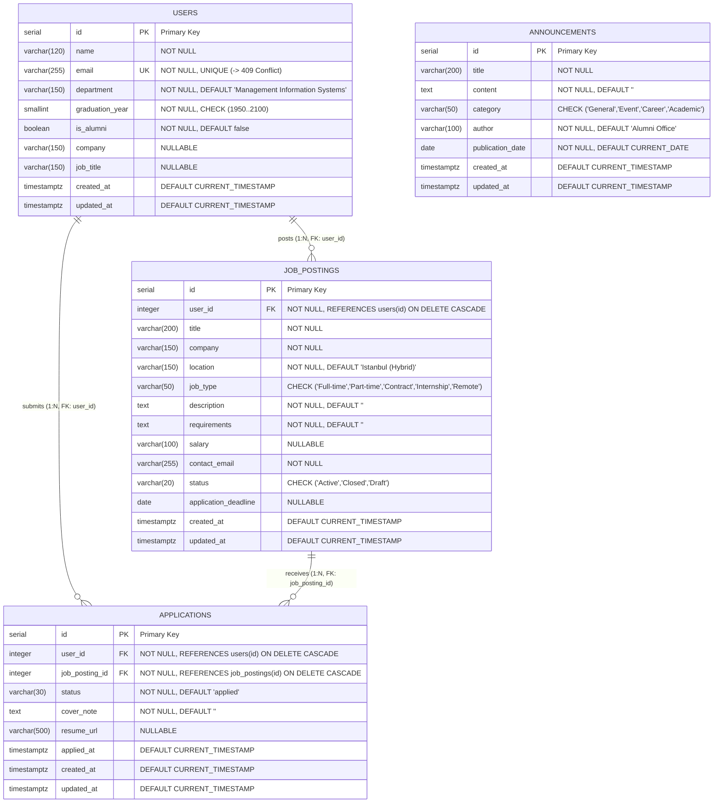

# 📐 Database Design Document (`ddd.md`)

> **System:** Alumni Tracking System  
> **Author:** Ege Gürkan Atalay (`egegurkanatalay@ogr.iu.edu.tr`)  
> **Institution:** Istanbul University · Faculty of Economics · Department of Management Information Systems (MIS)  
> **Course:** Web Programming (YBSB3001 · Fall 2026) · Assoc. Prof. Dr. Emre Akadal  
> **Source of Truth:** This document (`ddd.md`) is the single source of truth for all database tables, columns, data types, keys, relational links, delete rules, Docker volumes, and environment settings. Everything in `migrations/`, `models/`, and `factories/` is built directly from this specification.

---

## 📑 Table of Contents
1. [Architectural Purpose & The Forgetting Test](#1-architectural-purpose--the-forgetting-test)
2. [Database Engine, Volume & Environment Settings](#2-database-engine-volume--environment-settings)
3. [Entity-Relationship Diagram (ERD)](#3-entity-relationship-diagram-erd)
4. [Table Specifications & Data Dictionary](#4-table-specifications--data-dictionary)
   - [4.1 `users` Table (Alumni & Students)](#41-users-table-alumni--students)
   - [4.2 `announcements` Table (University & Alumni Notices)](#42-announcements-table-university--alumni-notices)
   - [4.3 `job_postings` Table (One-to-Many Relationship)](#43-job_postings-table-one-to-many-relationship)
   - [4.4 `applications` Table (Many-to-Many Join Table)](#44-applications-table-many-to-many-join-table)
5. [Relational Links, Foreign Keys & Unique Constraints](#5-relational-links-foreign-keys--unique-constraints)
6. [The Delete Rule Decision (`CASCADE` vs. `RESTRICT`)](#6-the-delete-rule-decision-cascade-vs-restrict)
7. [Migrations, Factories & Idempotent Seeding Strategy](#7-migrations-factories--idempotent-seeding-strategy)

---

## 1. Architectural Purpose & The Forgetting Test

In **Week 03** and **Week 04**, all records lived inside an in-memory JavaScript array (`this.users = [...]`) inside the Node.js process heap.
- **The Forgetting Test (Before Database):** Creating a new user via `POST /api/users`, restarting the server process (`docker compose restart` or restarting Node), and checking `GET /api/users` revealed that the newly created record was **gone**. Memory dies with the process.
- **The Forgetting Test (After Database):** By moving state into a dedicated **PostgreSQL 16 DBMS** container backed by a Docker **named volume (`pgdata`)**, records survive process restarts and `docker compose down`. Furthermore, because of our **MVC separation** (Week 04), **only the Model files (`models/*.js`) changed** when transitioning from the in-memory array to SQL queries; the Controllers only learned to `await` the asynchronous database response, while Routes and Views remained untouched.

---

## 2. Database Engine, Volume & Environment Settings

| Component | Setting / Name | Location & Purpose |
| :--- | :--- | :--- |
| **DBMS Engine** | **PostgreSQL 16** (`postgres:16-alpine`) | Defined as the `db` service in [`docker-compose.yml`](./docker-compose.yml). |
| **Named Volume** | `pgdata` (`/var/lib/postgresql/data`) | Docker folder stored outside the container. Survives `docker compose down`; only deleted when running `docker compose down -v`. |
| **Connection Pool** | [`models/db.js`](./models/db.js) (`pg.Pool`) | Centralized PostgreSQL connection pool reading `DATABASE_URL` or individual `POSTGRES_*` variables. |
| **Local Secrets** | `.env` | **Stays home, never committed to GitHub.** Listed in [`.gitignore`](./.gitignore) and [`.dockerignore`](./.dockerignore). |
| **Template Keys** | [`.env.example`](./.env.example) | Committed to GitHub with the exact same keys (`PORT`, `POSTGRES_USER`, `POSTGRES_PASSWORD`, `POSTGRES_DB`, `DB_HOST`, `DB_PORT`, `DATABASE_URL`) and no real password. |

---

## 3. Entity-Relationship Diagram (ERD)



---

## 4. Table Specifications & Data Dictionary

### 4.1 `users` Table (Alumni & Students)
* **One Resource Principle (Week 03):** An alumnus is a user who graduated; being an alumnus is a field (`is_alumni` / `isAlumni`, `graduation_year` / `graduationYear`), not a separate table.
* **Migration File:** [`migrations/001_create_users_and_announcements.sql`](./migrations/001_create_users_and_announcements.sql)

| Column Name | SQL Type | Keys & Constraints | Model Property | Validation & HTTP Rule |
| :--- | :--- | :--- | :--- | :--- |
| `id` | `SERIAL` | `PRIMARY KEY` | `id` | Auto-incrementing integer; never reused after deletion. |
| `name` | `VARCHAR(120)` | `NOT NULL` | `name` | Non-empty string (`400 Bad Request` if empty). |
| `email` | `VARCHAR(255)` | `NOT NULL, UNIQUE` | `email` | **Mandatory (`400 Bad Request` if missing/invalid); Unique (`409 Conflict` if sent twice).** |
| `department` | `VARCHAR(150)` | `NOT NULL, DEFAULT 'Management Information Systems'` | `department` | Academic department name. |
| `graduation_year` | `SMALLINT` | `NOT NULL, CHECK (1950..2100)` | `graduationYear` | Integer between 1950 and 2100 (`400 Bad Request` otherwise). |
| `is_alumni` | `BOOLEAN` | `NOT NULL, DEFAULT FALSE` | `isAlumni` | `true` for graduated alumni, `false` for current students. |
| `company` | `VARCHAR(150)` | `NULL` | `company` | Current employer (optional). |
| `job_title` | `VARCHAR(150)` | `NULL` | `jobTitle` | Current role/title (optional). |
| `created_at` | `TIMESTAMPTZ` | `DEFAULT CURRENT_TIMESTAMP` | `created_at` | Creation timestamp. |
| `updated_at` | `TIMESTAMPTZ` | `DEFAULT CURRENT_TIMESTAMP` | `updated_at` | Auto-updated via trigger `trg_users_updated_at`. |

---

### 4.2 `announcements` Table (University & Alumni Notices)
* **Migration File:** [`migrations/001_create_users_and_announcements.sql`](./migrations/001_create_users_and_announcements.sql)

| Column Name | SQL Type | Keys & Constraints | Model Property | Validation & HTTP Rule |
| :--- | :--- | :--- | :--- | :--- |
| `id` | `SERIAL` | `PRIMARY KEY` | `id` | Auto-incrementing primary key. |
| `title` | `VARCHAR(200)` | `NOT NULL` | `title` | Required headline, min 2 chars (`400 Bad Request` if missing). |
| `content` | `TEXT` | `NOT NULL, DEFAULT ''` | `content` | Announcement body text. |
| `category` | `VARCHAR(50)` | `NOT NULL, CHECK IN ('General','Event','Career','Academic')` | `category` | Categorization tag. |
| `author` | `VARCHAR(100)` | `NOT NULL, DEFAULT 'Alumni Office'` | `author` | Publishing unit or author. |
| `publication_date`| `DATE` | `NOT NULL, DEFAULT CURRENT_DATE` | `date` | ISO date `YYYY-MM-DD`. |

---

### 4.3 `job_postings` Table (One-to-Many Relationship)
* **Relationship:** One user (`users.id`) has many job postings; each job posting belongs to exactly one user (`job_postings.user_id`).
* **Migration File:** [`migrations/002_create_job_postings_and_applications.sql`](./migrations/002_create_job_postings_and_applications.sql)

| Column Name | SQL Type | Keys & Constraints | Model Property | Validation & HTTP Rule |
| :--- | :--- | :--- | :--- | :--- |
| `id` | `SERIAL` | `PRIMARY KEY` | `id` | Auto-incrementing primary key. |
| `user_id` | `INTEGER` | `NOT NULL, REFERENCES users(id) ON DELETE CASCADE` | `user_id` / `userId` | Foreign Key pointing to `users.id`. **If user does not exist -> `404 Not Found`.** |
| `title` | `VARCHAR(200)` | `NOT NULL` | `title` | Required job title (`400 Bad Request` if missing). |
| `company` | `VARCHAR(150)` | `NOT NULL` | `company` | Required hiring company (`400 Bad Request` if missing). |
| `location` | `VARCHAR(150)` | `NOT NULL, DEFAULT 'Istanbul (Hybrid)'` | `location` | Workplace location. |
| `job_type` | `VARCHAR(50)` | `NOT NULL, DEFAULT 'Full-time'` | `jobType` | `Full-time`, `Part-time`, `Contract`, `Internship`, `Remote`. |
| `description` | `TEXT` | `NOT NULL, DEFAULT ''` | `description` | Role responsibilities. |
| `requirements` | `TEXT` | `NOT NULL, DEFAULT ''` | `requirements` | Candidate qualifications. |
| `salary` | `VARCHAR(100)` | `NULL` | `salary` | Optional compensation range. |
| `contact_email` | `VARCHAR(255)` | `NOT NULL` | `contactEmail` | Contact email address. |
| `status` | `VARCHAR(20)` | `NOT NULL, DEFAULT 'Active'` | `status` | `Active`, `Closed`, `Draft`. |
| `application_deadline` | `DATE` | `NULL` | `applicationDeadline` | Optional cutoff date (`YYYY-MM-DD`). |

---

### 4.4 `applications` Table (Many-to-Many Join Table)
* **Relationship:** Many users apply to many job postings through this join table — one row per `(user_id, job_posting_id)`.
* **Why applicants cannot live in `job_postings` or `users`:** Storing an array of applicant IDs inside `job_postings` or job IDs inside `users` violates First Normal Form (1NF), prevents foreign key enforcement by the DBMS, makes querying both directions slow, and cannot store per-application attributes (`status`, `cover_note`, `applied_at`).
* **Migration File:** [`migrations/002_create_job_postings_and_applications.sql`](./migrations/002_create_job_postings_and_applications.sql)

| Column Name | SQL Type | Keys & Constraints | Model Property | Validation & HTTP Rule |
| :--- | :--- | :--- | :--- | :--- |
| `id` | `SERIAL` | `PRIMARY KEY` | `id` | Auto-incrementing primary key. |
| `user_id` | `INTEGER` | `NOT NULL, REFERENCES users(id) ON DELETE CASCADE` | `user_id` / `userId` | Foreign Key to applicant user (`404 Not Found` if user does not exist). |
| `job_posting_id` | `INTEGER` | `NOT NULL, REFERENCES job_postings(id) ON DELETE CASCADE` | `job_posting_id` / `jobPostingId` | Foreign Key to target job (`404 Not Found` if posting does not exist). |
| `status` | `VARCHAR(30)` | `NOT NULL, DEFAULT 'applied'` | `status` | `applied`, `interview`, `accepted`, `rejected`, `withdrawn`. |
| `cover_note` | `TEXT` | `NOT NULL, DEFAULT ''` | `coverNote` | Candidate application note. |
| `resume_url` | `VARCHAR(500)` | `NULL` | `resumeUrl` | Link to CV / portfolio. |
| `applied_at` | `TIMESTAMPTZ` | `DEFAULT CURRENT_TIMESTAMP` | `appliedAt` | Timestamp of application. |

---

## 5. Relational Links, Foreign Keys & Unique Constraints

1. **Nested Route Ownership (`/api/users/:id/jobs`):**
   - In `POST /api/users/:id/jobs` and `GET /api/users/:id/jobs`, the user's ID comes from the **URL path parameter (`:id`)**, never trusted from the request body alone. If `:id` does not exist in `users`, the controller immediately returns **`404 Not Found`**.
2. **Include / Eager Loading with `LEFT JOIN` (`GET /api/users/:id`):**
   - `GET /api/users/:id` executes a `LEFT JOIN` between `users` and `job_postings` so a single HTTP response returns the user object with `"jobs": [...]` inside.
   - **Why `LEFT JOIN` instead of plain `JOIN` (`INNER JOIN`)?** A user who has not posted any jobs yet must still be returned by `GET /api/users/:id` with an empty array `"jobs": []`. An `INNER JOIN` would exclude users with zero job postings, falsely causing a `404 Not Found`.
3. **Unique Pair Constraint (`UNIQUE (user_id, job_posting_id)`):**
   - Enforced by `CONSTRAINT uq_user_job_application UNIQUE (user_id, job_posting_id)` in PostgreSQL.
   - When the same user applies to the same job posting a second time via `POST /api/jobs/:id/applications`, PostgreSQL raises error `23505` (`unique_violation`), and the controller answers **`409 Conflict`**.

---

## 6. The Delete Rule Decision (`CASCADE` vs. `RESTRICT`)

* **Chosen Rule:** **`ON DELETE CASCADE`**
* **Where Applied:**
  - `job_postings.user_id REFERENCES users(id) ON DELETE CASCADE`
  - `applications.user_id REFERENCES users(id) ON DELETE CASCADE`
  - `applications.job_posting_id REFERENCES job_postings(id) ON DELETE CASCADE`
* **Reason & Justification:**
  1. **No Orphaned Records:** In an Alumni Tracking System, a job posting is published under the authority and contact identity of a specific alumnus (`user_id`), and an application represents that specific user's candidacy. If a user account is deleted (`DELETE /api/users/:id` -> `204 No Content`), leaving their job postings or applications behind would create orphaned records or broken references.
  2. **Clean Lifecycle & Compliance:** When a user withdraws from the platform, all dependent postings (`job_postings`) and candidate applications (`applications`) owned by that user are automatically and atomically cleaned up by PostgreSQL (`ON DELETE CASCADE`), preserving referential integrity across all three tables without requiring multi-step manual deletions.

---

## 7. Migrations, Factories & Idempotent Seeding Strategy

1. **Immutable Migration History (`migrations/`):**
   - Tables change **only** through numbered SQL migration files executed by [`scripts/migrate.js`](./scripts/migrate.js) (`npm run migrate`).
   - [`migrations/001_create_users_and_announcements.sql`](./migrations/001_create_users_and_announcements.sql) builds `users` and `announcements` (Week 05).
   - [`migrations/002_create_job_postings_and_applications.sql`](./migrations/002_create_job_postings_and_applications.sql) adds `job_postings` and `applications` as a **new migration** in Week 06 without editing `001`.
2. **Idempotent Seeding in Dependency Order (`scripts/seed.js`):**
   - Running `npm run seed` twice in a row always succeeds and produces clean, deterministic IDs starting from `1`.
   - Before inserting rows via [`factories/`](./factories), [`scripts/seed.js`](./scripts/seed.js) empties the tables in child-to-parent order (`applications` ➔ `job_postings` ➔ `announcements` ➔ `users`) and resets all primary key sequences:
     ```sql
     TRUNCATE TABLE applications, job_postings, announcements, users
     RESTART IDENTITY CASCADE;
     ```
